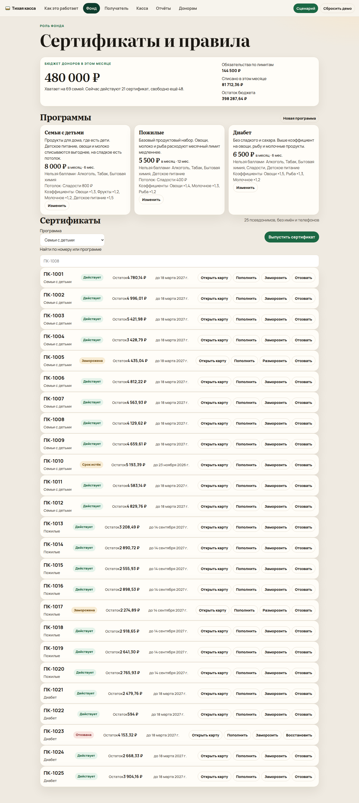
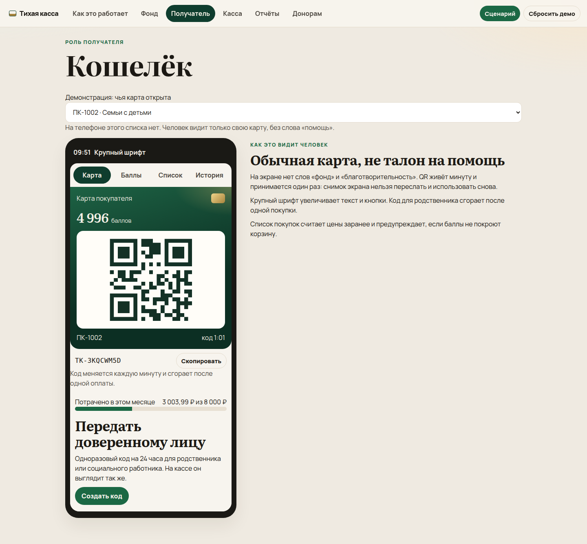
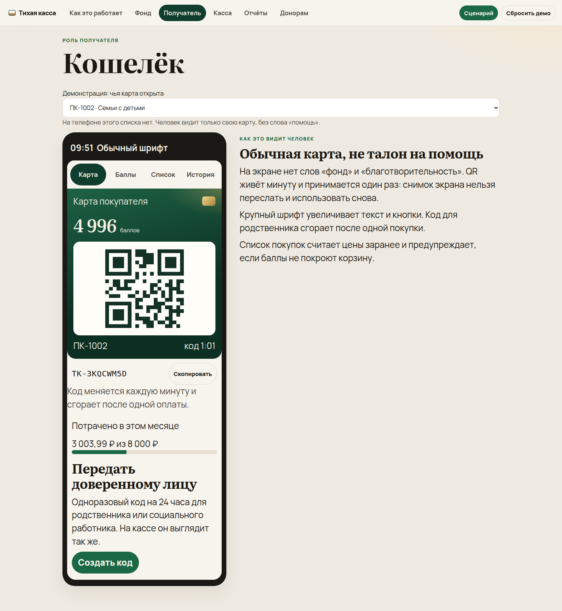
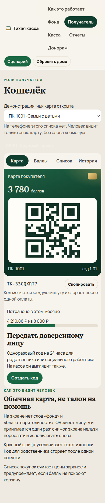
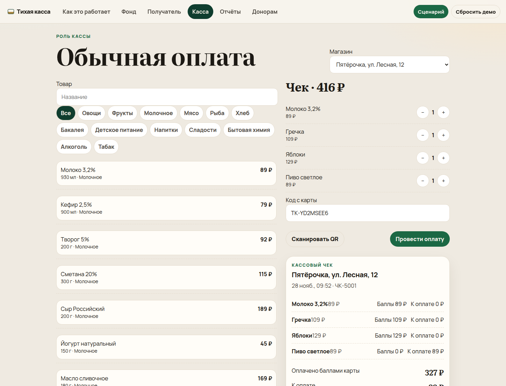
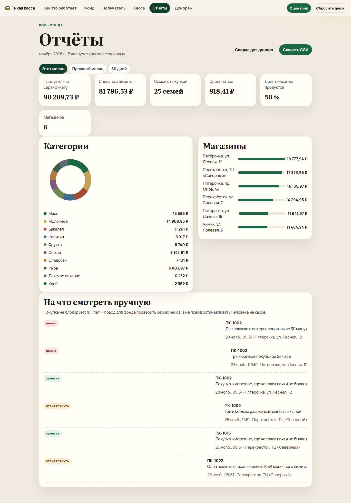
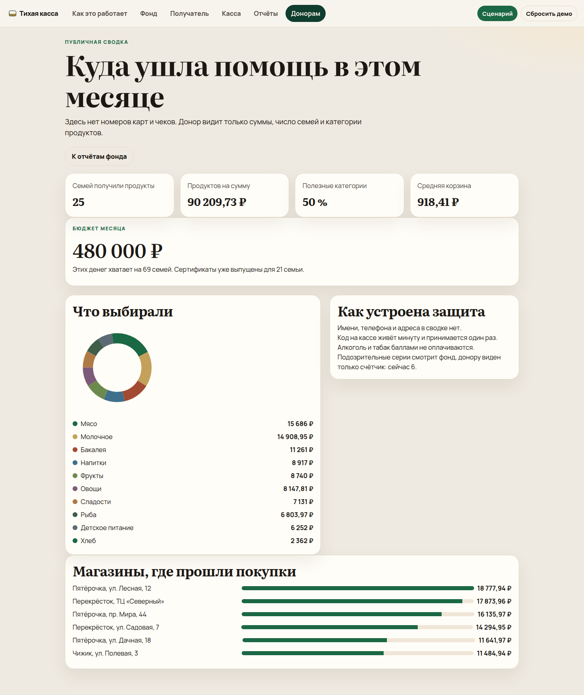

# Тихая касса

Продуктовый сертификат, который на кассе выглядит как обычная карта магазина. Человек сам выбирает еду и платит в общей очереди. Сосед и кассир не видят, что это помощь.

Прототип для конкурса «Вайбкодинг добрых дел» (X5 Клуб и благотворительный фонд X5 «Выручаем»).

Демо: [https://mk99anik-ship-it.github.io/x5project/](https://mk99anik-ship-it.github.io/x5project/)

## Проблема

Многие не приходят за продуктовой помощью: стоять в отдельной очереди за посылкой стыдно. Сам набор часто не подходит — другая еда, аллергия, дети, диабет. Фонду дорого закупать, хранить и развозить одинаковые коробки, хотя магазин рядом уже умеет продавать продукты.

## Решение

Фонд выпускает цифровой продуктовый сертификат. На телефоне это «Карта покупателя»: баланс, QR, без слов «фонд» и «помощь». Человек идёт в любой магазин сети, набирает нужное в пределах лимита и на обычной кассе показывает QR, как все. Разрешённые товары списываются баллами, остальное оплачивается как обычно.

В контуре нет фамилии, телефона и адреса. У сертификата псевдоним вида `ПК-1008`. Фонд видит обезличенные суммы, категории и сигналы о странных покупках.

## Роли

Переключатель в шапке. Входа по паролю нет: это демонстрация, данные живут в браузере.

1. **Фонд.** Программы («Семьи с детьми», «Пожилые», «Диабет»): лимит на месяц, срок, категории, потолок на сладкое, коэффициент на овощи, молоко и детское питание. Выпуск сертификата, пополнение, заморозка, отзыв, остатки. Бюджет доноров показывает, скольким семьям хватает денег.
2. **Получатель.** Экран телефона с нейтральной картой. QR настоящий, код живёт 60 секунд и сгорает после одной оплаты. Остаток, правила, история, список покупок с ценами и предупреждением, крупный шрифт, одноразовый код для доверенного лица на 24 часа.
3. **Касса.** Каталог из 60 товаров. Сканер QR камерой и ручной ввод кода (демо часто открыто на одном устройстве). Чек делится сам. На экране кассира только «Оплачено баллами карты» и сумма к доплате. Отказы: просроченный код, повтор, заморозка, истёкший срок карты, корзина больше остатка.
4. **Отчёты и страница донора.** Потраченное, число семей, категории, доля полезных продуктов, средний чек, магазины, флаги. CSV для фонда. Публичная сводка без номеров карт.

Кнопка «Сценарий» проводит по цепочке: фонд выпускает карту → человек открывает кошелёк → касса проводит чек с пивом → отчёт обновляется. «Сбросить демо» возвращает исходные данные. Две вкладки видят одни и те же сертификаты: состояние пишется в `localStorage` и синхронизируется событием `storage`.

## Как делится чек

Касса отправляет корзину и код. Сервис смотрит программу карты и считает каждую строку в копейках.

- Алкоголь и табак не оплачиваются баллами никогда, даже если их случайно включили в программу. Бытовая химия и другие закрытые категории тоже уходят в обычную оплату.
- На овощи, фрукты, молоко, рыбу и детское питание фонд может поставить коэффициент. При 1,3 за 130 ₽ овощей с лимита списывается 100 ₽, а на полке продукт покрыт целиком. Семья получает больше полезной еды в том же лимите.
- У категории может быть потолок на месяц. Сладкое в программе «Семьи с детьми» — не больше 800 ₽. Дальше эта категория идёт в доплату.
- Остаток баллов тратится по порядку строк. Хвост, который не влез, человек оплачивает сам.
- Сумма строки всегда равна покрытию баллами плюс доплата. С лимита не списывается больше остатка.

На чеке кассира покрытие показано как баллы карты. Пояснение «почему так разделилось» в прототипе спрятано под спойлер и подписано: на боевой кассе этого блока нет.

## Антифрод

Оплата не блокируется из-за подозрения. Флаг — повод для фонда посмотреть серию чеков.

- две покупки с интервалом меньше 30 минут;
- три и больше покупок за 24 часа;
- три и больше разных магазинов за 7 дней;
- покупка в магазине, где человек почти не бывает;
- один чек списал больше 85% месячного лимита.

Сам код защищает от пересылки скриншота: он одноразовый. Свой код живёт минуту, код доверенного лица — сутки и тоже один раз. Повтор, просрочка, заморозка и отозванная карта на кассе не проходят. Донор видит только число таких сигналов, без номеров.

## Критерии жюри

**Практическая польза.** Человеку не нужно объяснять свою ситуацию в очереди, и он берёт ту еду, которая нужна семье, а не типовой набор. Фонд не держит склад и раздачу: деньги идут в чек магазина, бюджет считается в семьях, отчёт показывает категории и полезную еду.

**Возможность реализации.** Сертификат — тип счёта в уже работающей лояльности X5, а не новая касса. Пилот: один город, одна программа, «Пятёрочка», около 200 карт. Дальше правила категорий встают в API кассы: корзина на входе, две суммы на выходе. Потом «Перекрёсток», «Чижик» и кабинет донора. Персональных данных в этом контуре нет: так прототип закладывает минимизацию по логике 152-ФЗ. Связь псевдонима с человеком, если она нужна, остаётся у фонда и на кассу не передаётся.

**Качество и работоспособность.** Четыре роли и сценарий для жюри проходят от выпуска карты до обновления отчёта. Проверены просроченный и повторный код, заморозка, истёкшая карта, алкоголь в чеке, корзина больше лимита, крупный шрифт, узкий экран и синхронизация вкладок. Правила чека, кодов, антифрода и отчётов покрыты модульными тестами.

**Оригинальность.** Помощь спрятана в привычный жест «показать карту на кассе». Очередь видит баллы, а не талон. Код вращается, чек режется по категориям, полезная еда растягивает лимит.

## Как внедрить

1. Пилот в одном городе на текущем списании баллов лояльности. Фонд задаёт лимит и категории, отдельного окна выдачи нет.
2. Одноразовый код в том же QR, что карта покупателя. Касса получает две суммы до фискализации: баллы и доплату.
3. Вся сеть и публичная сводка для донора: семьи, категории, доля овощей и молока. Пофамильного списка нет.

## Скриншоты

Главная:


Фонд:



Кошелёк получателя:



Крупный шрифт:



Телефон:



Касса. Пиво ушло в доплату, молоко, гречка и яблоки — в баллы:



Отчёты фонда:



Сводка для донора:



## Запуск

Нужен Node.js 22.

```bash
npm install
npm test
npm run lint
npm run dev
```

Приложение откроется на [http://localhost:5173/x5project/](http://localhost:5173/x5project/). Сборка: `npm run build`.

Публикация на GitHub Pages настроена в `.github/workflows/pages.yml`: при пуше в `main` прогоняются тесты и сборка, сайт выкладывается с базовым путём `/x5project/`. В настройках репозитория источник Pages нужно поставить в GitHub Actions.

В демо уже три программы, 25 сертификатов и история покупок примерно за два месяца. Всё хранится только в браузере.

## Лицензия

MIT. Текст в файле [LICENSE](LICENSE).
