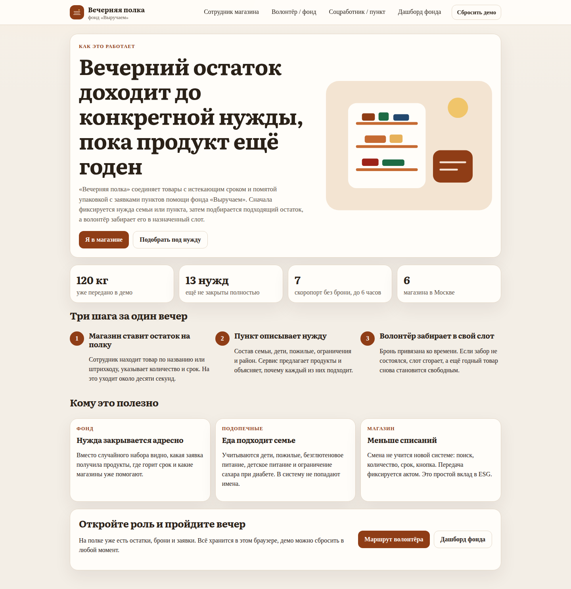
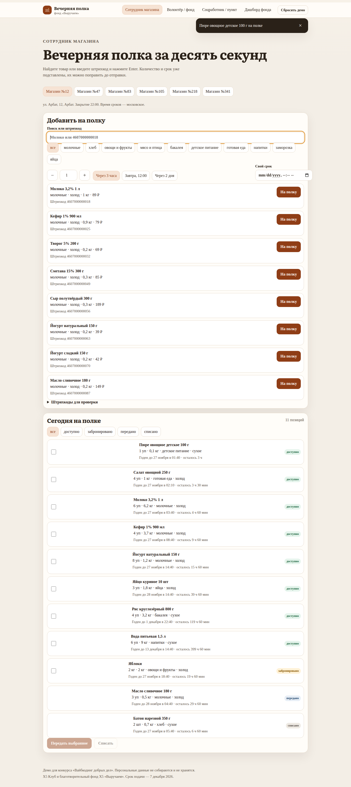
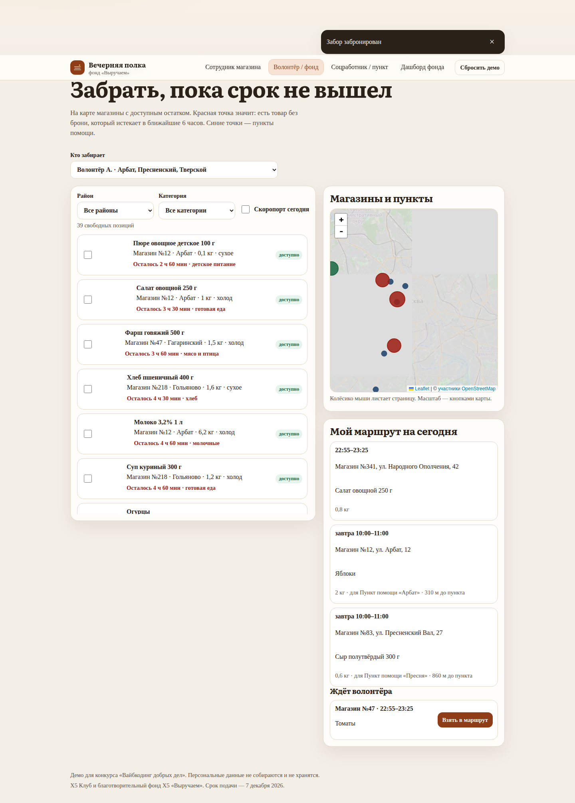
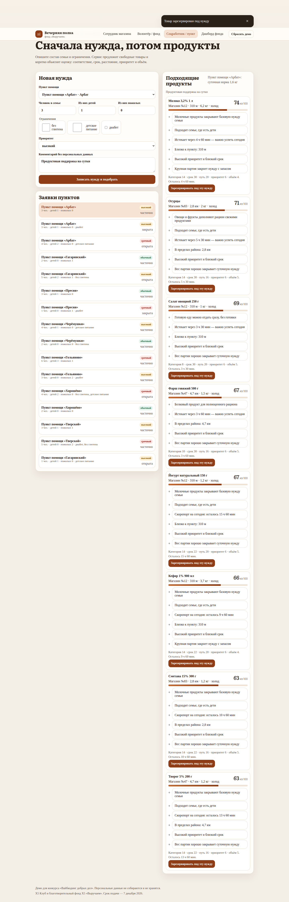
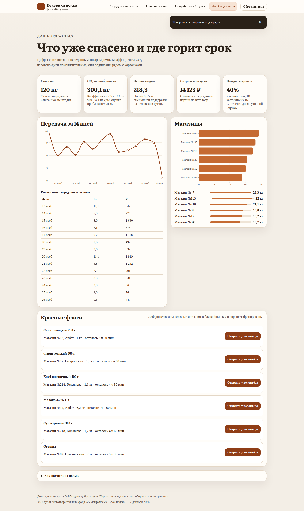
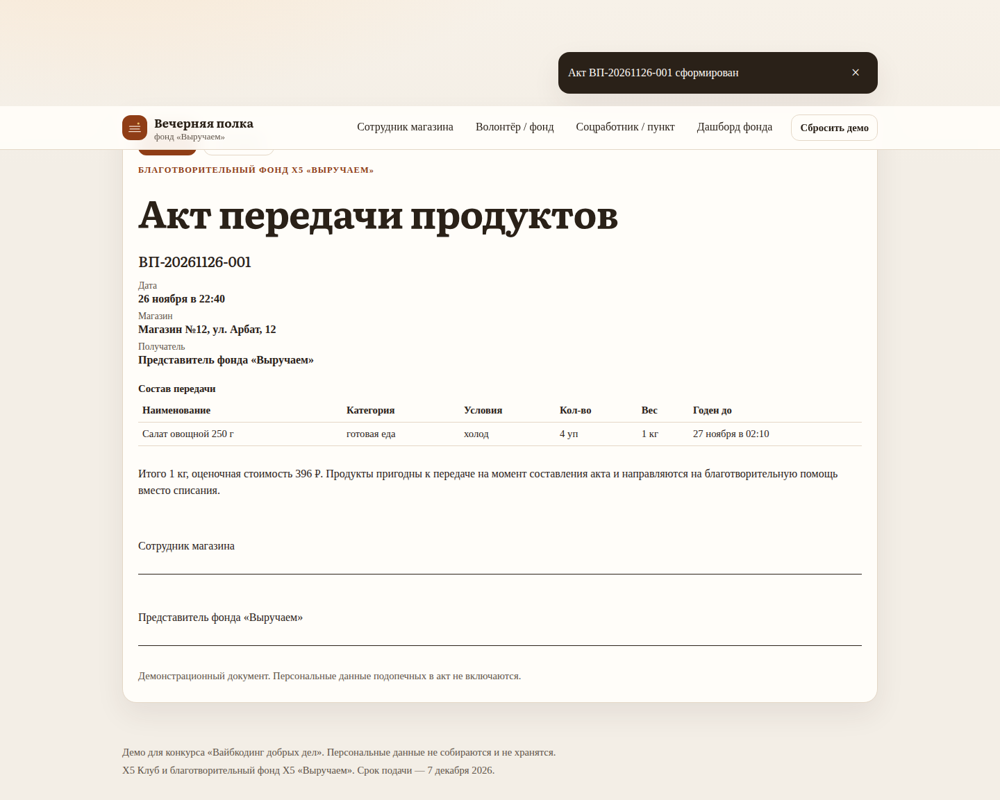

# Вечерняя полка

Сервис для конкурса «Вайбкодинг добрых дел» (X5 Клуб и благотворительный фонд X5 «Выручаем»).

Живое демо: [https://mk99anik-ship-it.github.io/x5project/](https://mk99anik-ship-it.github.io/x5project/)

Срок подачи — 7 декабря 2026. Заявка на конкурс — ссылка на этот репозиторий.

«Вечерняя полка» соединяет вечерние остатки магазинов (истекающий срок, помятая упаковка) с нуждами пунктов помощи. Подбор начинается с заявки конкретной точки, а не с витрины остатков: система объясняет, почему товар подходит семье, а волонтёр забирает его в слот, пока продукт ещё годен.

Данные демонстрационные и лежат в браузере. Персональные данные не используются: у семей есть только состав и ограничения, у волонтёров — позывные.

## Проблема

К концу дня в магазине остаются продукты, которые ещё можно отдать, но уже неудобно продавать. Если их не забрать в тот же вечер, партия списывается. Фонду при этом нужны не «какие получится» продукты, а набор под состав семьи: дети, пожилые, без глютена, детское питание, ограничение сахара. Случайная коробка с полки эту нужду закрывает плохо, а скоропорт без записи на забор просто не успевает доехать.

## Решение

Один вечер, четыре роли, без сервера:

1. Сотрудник магазина за несколько секунд ставит партию на полку: поиск или штрихкод, количество, срок, категория и условия хранения.
2. Соцработник описывает нужду пункта. Сервис предлагает свободные товары и объясняет оценку.
3. Волонтёр видит магазины на карте, фильтрует остаток и бронирует слот. Если слот прошёл, а товар ещё годен, он снова свободен.
4. Дашборд фонда показывает спасённый вес, оценку CO₂, человеко-дни, стоимость, долю закрытых нужд и красные флаги: скоропорт в ближайшие 6 часов без брони.

Передача в магазине подтверждается и открывает простой акт, который можно напечатать.

## Роли

Переключатель в шапке. Входа с паролем нет.

| Роль | Что делает |
| --- | --- |
| Сотрудник магазина | Выбирает магазин, добавляет товар, ведёт сегодняшнюю полку (доступно / забронировано / передано / списано), оформляет акт |
| Волонтёр / фонд | Карта и список, фильтры по району, категории и «скоропорт сегодня», бронь слота, маршрут на сегодня |
| Соцработник / пункт помощи | Заявка: размер семьи, дети, пожилые, ограничения, приоритет, район. Резерв подобранных товаров под эту нужду |
| Дашборд фонда | Сводка, графики за 14 дней, топ магазинов, красные флаги |

Кнопка «Сбросить демо» возвращает исходный набор. Если открыть сервис на следующий календарный день по Москве, демо собирается заново само.

## Как устроен подбор

Считаются только свободные и ещё годные товары. Оценка до 100 складывается из пяти частей:

| Часть | Максимум | Смысл |
| --- | --- | --- |
| Соответствие | 35 | Категория, без глютена, детское питание, сахар при диабете, удобство для детей и пожилых |
| Срок | 30 | Чем ближе конец срока, тем выше товар |
| Расстояние | 20 | От магазина до пункта помощи |
| Приоритет | 10 | Срочная и высокая нужда дополнительно поднимает близкий срок |
| Объём | 5 | Насколько вес партии закрывает суточную норму заявки |

Товар с глютеном не предлагается, если в заявке стоит «без глютена». У каждой строки есть текст, зачем она в списке, и раскладка баллов.

Суточная норма заявки (учебная, для планирования выдачи, не медицинская):

- взрослый — 0,6 кг
- ребёнок — 0,4 кг
- пожилой человек — 0,5 кг

Взрослые — это размер семьи минус дети и пожилые. Заявка закрыта, когда бронь и уже переданные товары набирают эту норму. В проценте по фонду каждый килограмм считается только до нормы своей заявки, чтобы одна крупная партия не закрывала чужие нужды.

На карточке «человеко-дни» все переданные килограммы делятся на 0,55 кг. Так цифра не приписывает конкретный продукт конкретному человеку.

CO₂: 2,5 кг CO₂-эквивалента на 1 кг еды. Это обобщённый коэффициент по оценкам FAO и WRAP для смешанной корзины. Для отдельной категории он другой, поэтому в интерфейсе он подписан как приблизительный.

Слоты забора — вечерние получасовые окна. Если вечер уже прошёл, предлагается утро следующего дня. Для партии, которая не доживёт до окна, остаётся короткий слот в ближайшие минуты. Незабранная бронь снимается, когда слот закончился.

## Польза по критериям жюри

**Практическая польза.** Фонд видит, какая заявка ещё открыта и где продукт сгорит без брони. Пункт получает не случайный набор, а объяснённый подбор под состав семьи. Магазин сокращает списание тем, что остаток уходит актом в тот же вечер.

**Реализуемость.** Сценарий сотрудника укладывается в поиск, количество, срок и одну кнопку. Модель данных уже похожа на то, что отдаёт учётная система: магазин, штрихкод, партия, срок, вес, статус. Демо можно показать без внедрения.

**Рабочее состояние.** Четыре роли проходят на демо-данных от полки до акта. Подбор и расчёты дашборда покрыты модульными тестами. Сборка проверяется в GitHub Actions вместе с выкладкой на Pages.

**Свой угол.** Заявка пункта — начало цепочки. Остаток без нужды остаётся на карте у волонтёра, но рекомендация соцработнику строится от семьи и срока, а не от того, что магазину удобнее отдать первым.

## Скриншоты

Главная:



Сотрудник магазина:



Волонтёр, карта и маршрут:



Соцработник и подбор:



Дашборд фонда:



Акт передачи:



## Данные

Шесть магазинов в Москве с нейтральными названиями «Магазин №…», пункты помощи, четыре волонтёра, каталог со штрихкодами, больше сорока партий на сегодняшней полке и история передач за две недели, пятнадцать нужд. Адреса и координаты нужны только для карты и расстояния.

Хранилище браузера: ключ `vechernyaya-polka-v1`.

## Как это могло бы встать в реальную розницу

Сейчас всё считается в браузере. Дальше те же сущности можно отдавать по API учётной системы магазина:

- остатки и партии со сроком годности и штрихкодом, без ручного поиска;
- кнопка «на вечернюю полку» как проведение в учётной системе, чтобы партия не продавалась и не списывалась второй раз;
- акт передачи — документ для уменьшения списания.

Волонтёрам достаточно Telegram-бота: новая бронь, магазин, слот, напоминание и кнопка «забрал». Пункт помощи по-прежнему не передаёт фамилии: в заявке остаются район, состав семьи и ограничения.

Личные кабинеты и боевые интеграции сознательно не входят в демо.

## Запуск

Нужен Node.js 20 или новее.

```bash
npm install
npm test
npm run lint
npm run dev
```

Сборка и проверка типов:

```bash
npm run build
npm run preview
```

Тесты — Vitest, без браузера: алгоритм подбора, нормы, CO₂, человеко-дни, красные флаги, сгорание брони.

В разработке адрес `http://127.0.0.1:5173/`. В сборке для GitHub Pages базовый путь `/x5project/`.

## Публикация

Workflow `.github/workflows/pages.yml` на ветке `main` гоняет линт, тесты и сборку, затем выкладывает `dist` через GitHub Actions.

Чтобы демо открылось, в настройках репозитория нужно один раз выбрать **Settings → Pages → Build and deployment → Source: GitHub Actions**. После пуша в `main` адрес будет [https://mk99anik-ship-it.github.io/x5project/](https://mk99anik-ship-it.github.io/x5project/).

## Лицензия

MIT. Текст — в файле [LICENSE](LICENSE).
