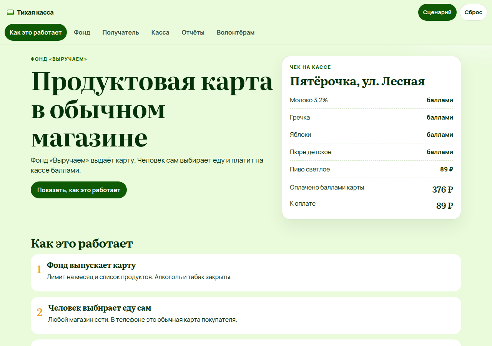
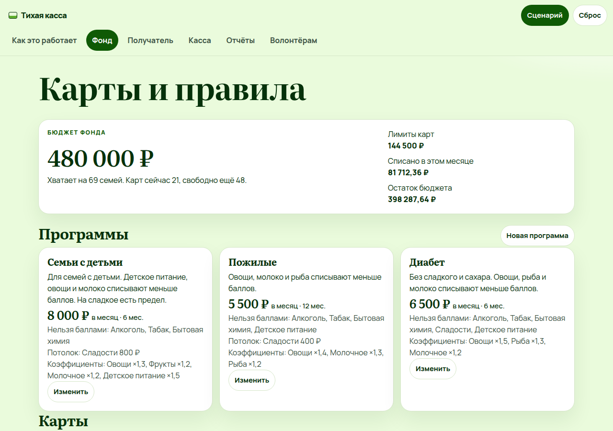
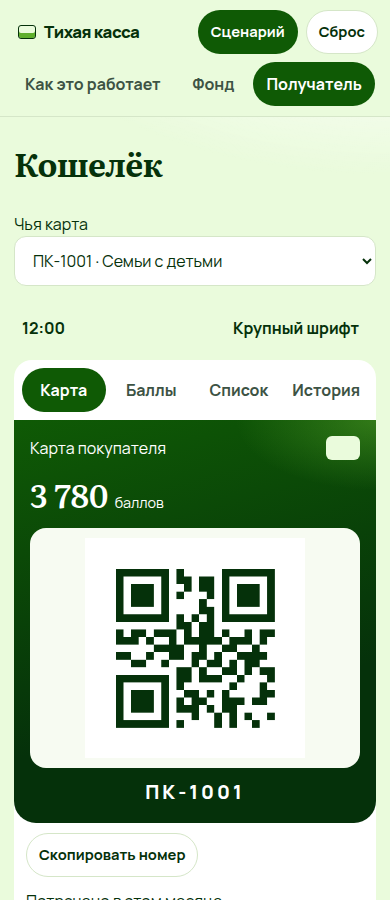
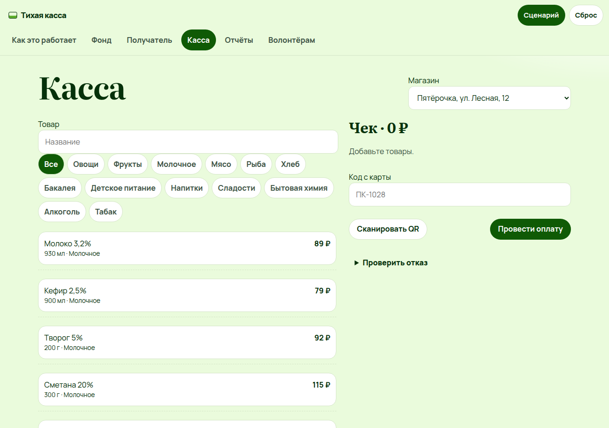
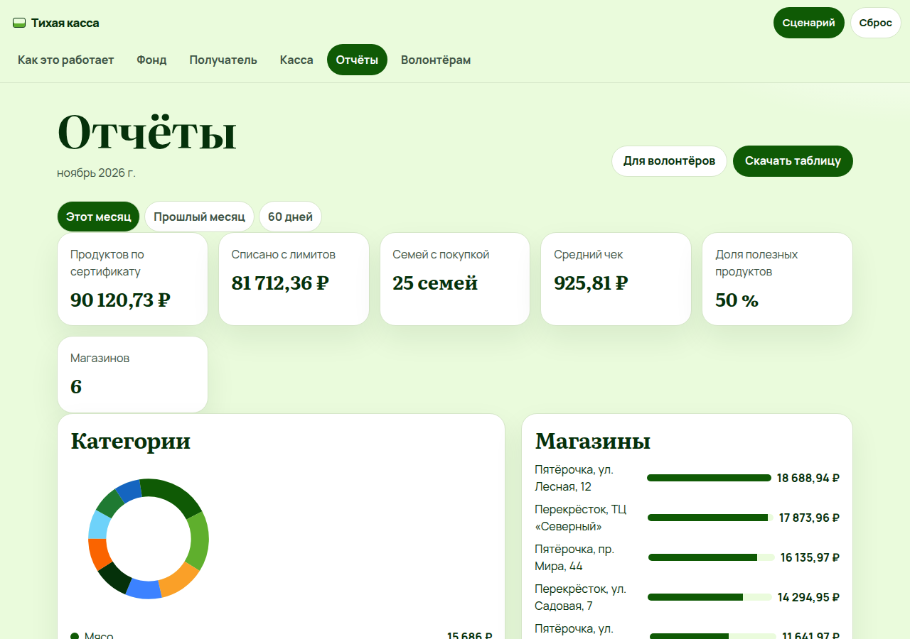

# Тихая касса

Прототип продуктовой карты для фонда «Выручаем». Фонд выдаёт человеку карту, и он покупает продукты в обычном магазине сети, как все.

Демо: [mk99anik-ship-it.github.io/x5project](https://mk99anik-ship-it.github.io/x5project/)

## Зачем

Продуктовые наборы не всегда подходят: у кого-то аллергия, у кого-то маленькие дети или диабет. Фонду приходится держать склад и организовывать выдачу, хотя продукты и так продаются в магазине рядом.

С картой человек сам выбирает, что купить. Фонд задаёт лимит на месяц и список разрешённых продуктов. Имя и телефон в системе не хранятся, у карты есть только номер, например `ПК-1008`. Алкоголь и табак по карте не оплатить. Если баллов не хватает, остаток человек доплачивает сам.

## Разделы

Разделы переключаются в шапке. Входить не нужно, все данные хранятся в браузере.

- **Фонд.** Здесь настраиваются программы «Семьи с детьми», «Пожилые» и «Диабет»: лимит, срок действия, разрешённые категории, ограничение на сладкое. На овощи, молочку и детское питание можно поставить льготный коэффициент. Отсюда же фонд выпускает, пополняет, замораживает и отзывает карты и видит, на сколько семей хватит бюджета.
- **Получатель.** Так карта выглядит в телефоне: QR с номером карты, остаток, история покупок и подсказка, что можно купить. Есть режим крупного шрифта. Для родственника можно сделать разовый код на одну покупку.
- **Касса.** Каталог товаров, сканер и поле для номера карты. В чеке видно, сколько оплачено баллами и сколько осталось доплатить. Касса не примет просроченный или уже использованный код, замороженную карту и карту с истёкшим сроком.
- **Отчёты.** Траты по категориям и магазинам, число семей, средний чек и подозрительные покупки. Данные можно выгрузить в CSV.
- **Волонтёрам.** Общая статистика без номеров карт: скольким семьям помогли и сколько мест осталось в программах.

Кнопка «Сценарий» по шагам проводит от выпуска карты до отчёта, кнопка «Сброс» возвращает исходные данные.

## Как делится чек

- Алкоголь, табак и всё, чего нет в программе, оплачивается своими деньгами.
- Для полезных категорий можно задать коэффициент. Например, при коэффициенте 1,3 овощи на 130 ₽ спишут с лимита только 100 ₽.
- На категорию можно поставить месячный предел: например, сладкого для семей с детьми не больше чем на 800 ₽.
- Баллы списываются по порядку позиций в чеке, а то, на что их не хватило, оплачивается обычным способом.

## Подозрительные покупки

Оплату они не блокируют. Фонд просто получает отметку, что стоит посмотреть чеки, если:

- две покупки сделаны с разницей меньше 30 минут;
- за сутки было три покупки и больше;
- за неделю карту использовали в трёх разных магазинах;
- покупка сделана в магазине, где человек обычно не бывает;
- один чек больше 85% месячного лимита.

## Как это внедрить

Карта может работать на баллах, которые кассы X5 уже умеют списывать. Начать можно с одного города и «Пятёрочки», потом подключить «Перекрёсток» и «Чижик». На кассу уходит только номер карты, без имени.

## Скриншоты











## Запуск

Нужен Node.js 22.

```bash
npm install
npm test
npm run lint
npm run dev
```

После запуска откройте [localhost:5173/x5project](http://localhost:5173/x5project/). Сборка выполняется командой `npm run build`. Сайт публикуется на GitHub Pages автоматически при каждом пуше в `main` (`.github/workflows/pages.yml`).

В демо три программы, 25 карт и покупки примерно за два месяца.

## Лицензия

MIT, см. [LICENSE](LICENSE).
