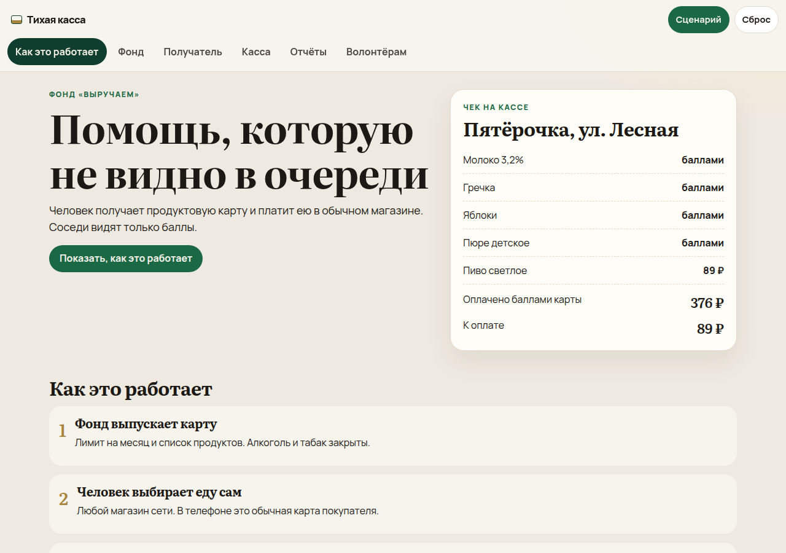
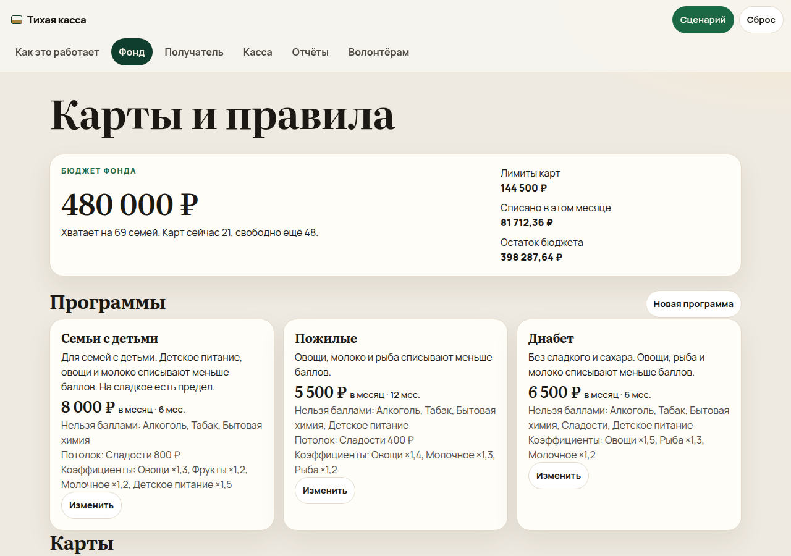
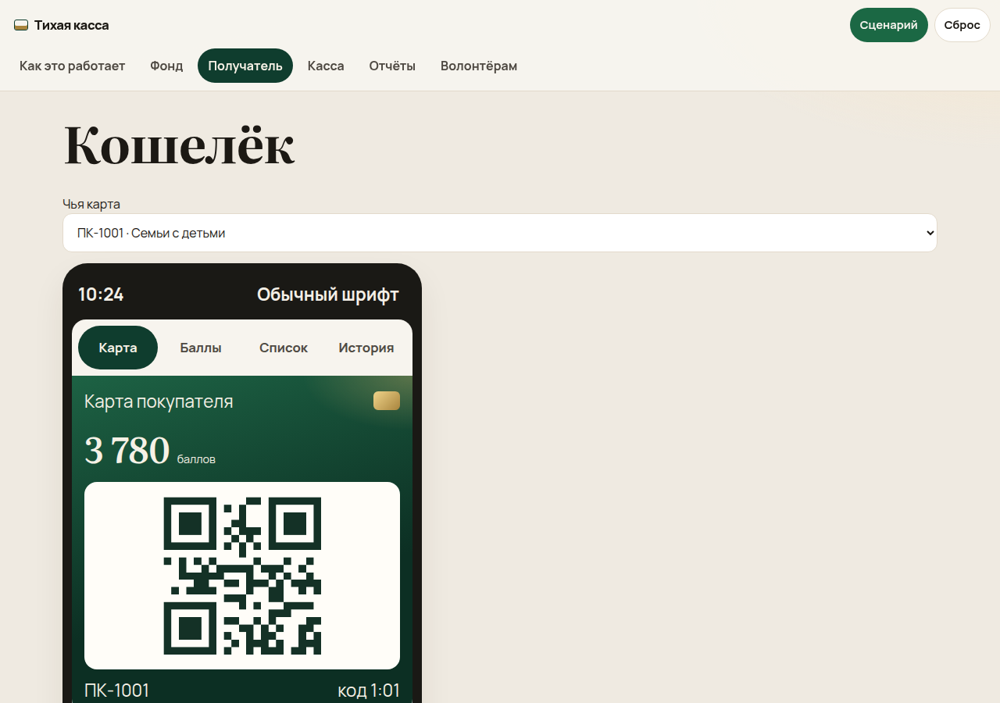
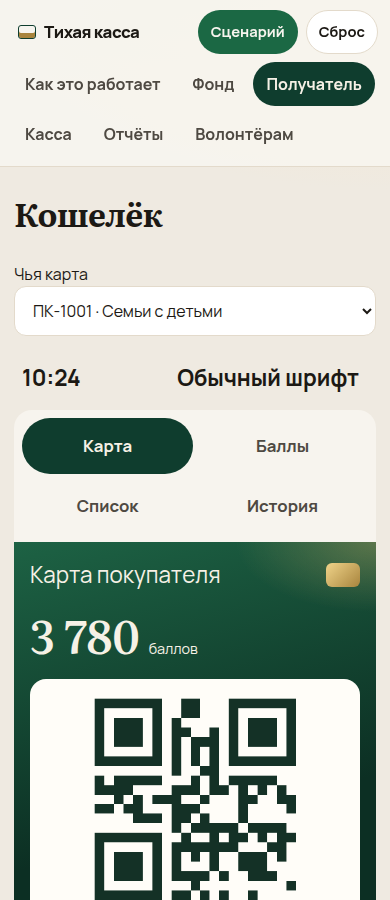
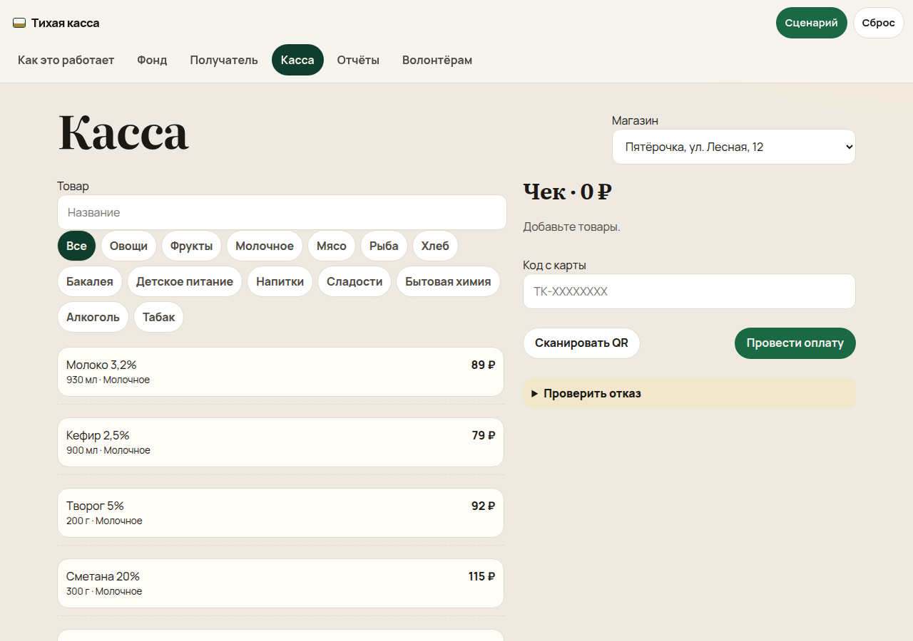
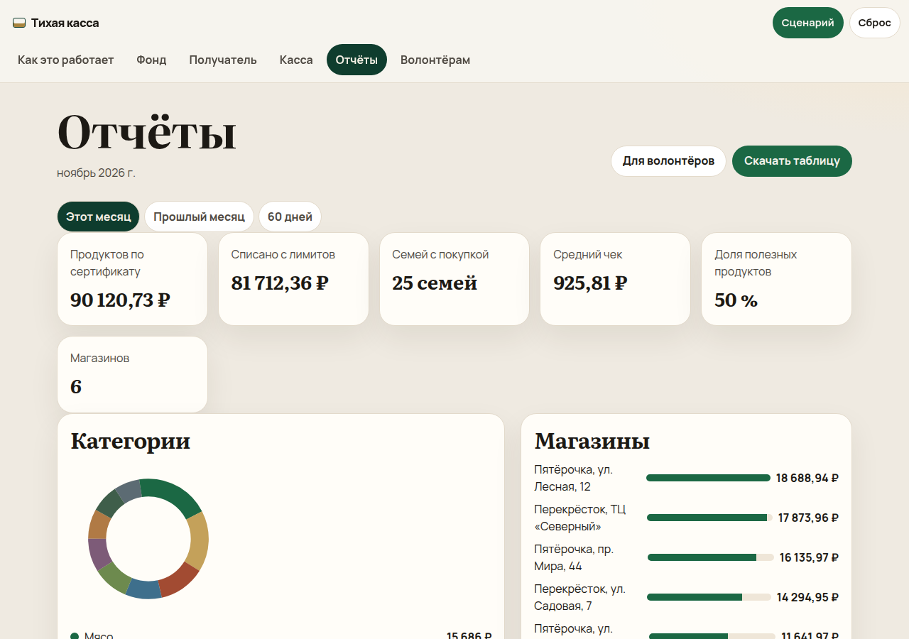
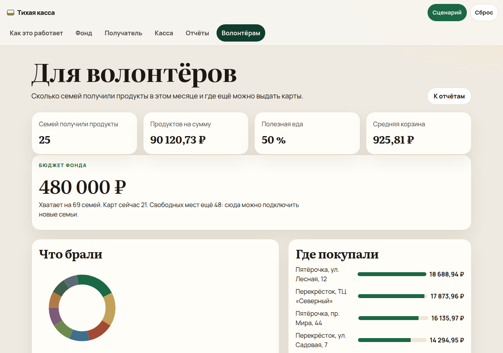

# Тихая касса

Продуктовая карта, которой платят в обычной очереди. Соседи видят только баллы.

Демо: [https://mk99anik-ship-it.github.io/x5project/](https://mk99anik-ship-it.github.io/x5project/)

## Задача

За посылкой стоят отдельно, и многим это стыдно. Набор часто не подходит: аллергия, дети, диабет. Фонду дорого держать склад, хотя магазин рядом уже продаёт еду.

Фонд выдаёт карту с номером вроде `ПК-1008`. Имени и телефона в программе нет. Человек сам выбирает продукты в любом магазине сети и платит на общей кассе. Алкоголь и табак баллами не проходят. Если баллов не хватает, остаток оплачивается как обычно.

## Кто что видит

Переключатель в шапке. Пароля нет, данные остаются в браузере.

1. **Фонд.** Программы «Семьи с детьми», «Пожилые» и «Диабет»: лимит, срок, что можно брать баллами, предел на сладкое. Овощи, молоко и детское питание списывают меньше баллов. Фонд выпускает карту, пополняет, замораживает и отзывает. Бюджет фонда показывает, скольким семьям хватает денег.
2. **Получатель.** Телефон с обычной картой покупателя. Код на QR живёт минуту и сгорает после одной оплаты. Остаток, список покупок с ценами, история, крупный шрифт, код для родственника на сутки.
3. **Касса.** Каталог, сканер и поле для кода. На чеке написано «Оплачено баллами карты» и сумма к доплате. Касса отказывает, если код просрочен, уже использован, карта заморожена или срок карты вышел.
4. **Отчёты и страница для волонтёров.** Суммы, число семей, категории, доля полезной еды, средний чек, магазины, странные покупки. Таблицу можно скачать. У волонтёров нет номеров карт: видно, скольким семьям помогли и где ещё есть свободные места.

Кнопка «Сценарий» проводит путь от выпуска карты до отчёта. «Сброс» возвращает исходные данные. Две вкладки браузера видят одни и те же карты.

## Как делится чек

- Алкоголь и табак всегда за свои деньги. То же с продуктами, которых нет в программе.
- На овощи, молоко, рыбу и детское питание можно поставить коэффициент. При 1,3 за 130 ₽ овощей с лимита списывается 100 ₽, а продукт на кассе покрыт целиком.
- У категории бывает предел на месяц. Сладкое у семей с детьми не больше 800 ₽.
- Баллы тратятся по порядку строк. Хвост человек доплачивает сам.

## Странные покупки

Касса из-за них оплату не останавливает. Фонд видит повод посмотреть чеки:

- две покупки ближе 30 минут;
- три покупки за сутки;
- три разных магазина за неделю;
- магазин, где человек почти не бывает;
- один чек больше 85% лимита.

Свой код живёт минуту, код родственника сутки. Оба сгорают после одной оплаты.

## На что смотрит жюри

**Польза.** Человеку не нужно объясняться в отдельной очереди, и он берёт ту еду, которая нужна семье. Фонд не держит склад. Бюджет считается в семьях.

**Как это сделать в сети.** Карта садится на баллы, которые касса уже умеет списывать. Сначала один город и «Пятёрочка». Потом касса получает две суммы: баллы и доплату. Дальше «Перекрёсток», «Чижик» и страница для волонтёров. Имя на кассу не передаётся.

**Как это работает здесь.** Четыре роли и сценарий проходят от новой карты до отчёта. Проверены просроченный и повторный код, заморозка, конец срока карты, алкоголь в чеке, корзина больше лимита, крупный шрифт и узкий экран. Правила чека, кодов и отчётов покрыты тестами.

**Чем это отличается.** Помощь выглядит как обычная карта магазина. Очередь видит баллы, а не талон.

## Скриншоты

После правок текста и вёрстки. Снимки «до» лежат в [docs/before](docs/before), «после» в [docs/after](docs/after).
















## Запуск

Нужен Node.js 22.

```bash
npm install
npm test
npm run lint
npm run dev
```

Адрес: [http://localhost:5173/x5project/](http://localhost:5173/x5project/). Сборка: `npm run build`.

Сайт на GitHub Pages собирается из `.github/workflows/pages.yml` при пуше в `main`. В настройках репозитория источник Pages: GitHub Actions.

В учебных данных три программы, 25 карт и покупки примерно за два месяца. Всё хранится только в браузере.

## Лицензия

MIT. Текст в файле [LICENSE](LICENSE).
